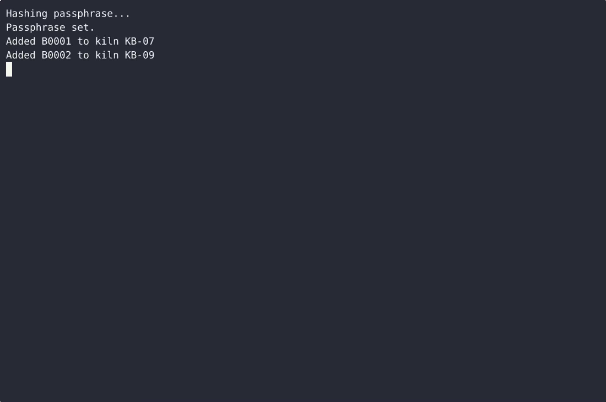
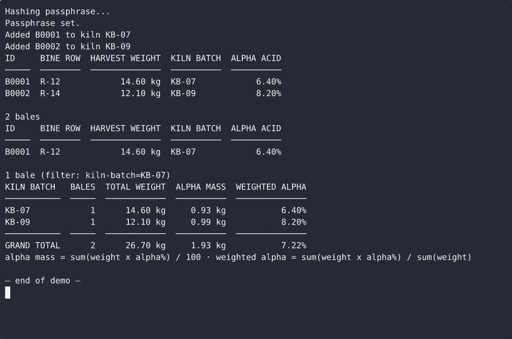

# HopBaleCount — complete Full-stack app command-line tool example app

**HopBaleCount** gives you two paths: self-host the Apache-2.0-licensed Full-stack app source as your own command-line tool, or [open it on cenius.ai](https://cenius.ai/marketplace/p/hopbalecount?ref=gh&utm_campaign=hopbalecount-webapp), describe the changes you want, and receive a new HopBaleCount build with full rebrand rights. Phase 1 ships a single-file, standard-library Python CLI that records hop bales with bine row, harvest weight, drying kiln batch ID, and alpha acid percent; persists them to a local JSON file next to the script; lists…. Everything ships in this repo — no paywall, no hidden features, no separate HopBaleCount download.


[](LICENSE)  [](https://cenius.ai)

[](https://cenius.ai/marketplace/p/hopbalecount?ref=gh&utm_campaign=hopbalecount-webapp)

> **▶ [Open & edit in cenius.ai](https://cenius.ai/marketplace/p/hopbalecount?ref=gh&utm_campaign=hopbalecount-webapp)** — one click to an editable workspace: describe changes in plain English, get an instant preview, one-click deploy and host. Modifications made on the platform come with full rebrand & relicense rights.

_Local clone? See [Quick start](#quick-start) below. cenius.ai is the zero-setup path._

## Demo


▶ **[Full demo walkthrough](https://cenius.ai/marketplace/p/hopbalecount?ref=gh&utm_campaign=hopbalecount-webapp)** — watch it on the project page · [download MP4](.github/media/demo.mp4)

## Screenshots

 

## Quick start

```bash
./install.sh   # installs dependencies + seeds demo data
```

See [`INSTALL.md`](INSTALL.md) for full setup and usage instructions.

## Architecture

A self-contained Full-stack app project (28 files): top-level directories include `tests/`. Dependency management and data seeding are both handled by `./install.sh` — run it once, then start the server. Step-by-step setup guide: [`INSTALL.md`](INSTALL.md).

## Features

- Record a hop bale
- Persist bales to local JSON
- List stored bales
- Harvest and alpha-acid summaries
- Clean minimal CLI navigation

## Usage guide

Four command surfaces: `session`, `add`, `list`, `summary`. Global options:
`--data-file PATH`, `--no-color`, `--version`, `--help`.

### The passphrase gate

The first data command run against a store without an `auth` block asks you to
choose the operator passphrase (minimum 8 characters, typed twice). Only a
salted PBKDF2-HMAC-SHA256 hash - algorithm, 200000 iterations, 16-byte salt,
32-byte digest - is written to the store; the passphrase itself is never stored
or echoed. Every later command prompts for it first (`getpass`, so nothing is
shown). Three wrong attempts print `Error: incorrect passphrase (3 of 3)` and
exit 5 without touching the data file.

```bash
hopbalecount session            # create on first run, otherwise verify
hopbalecount session --status   # store path, schema, passphrase state, bale count
```

`session --status` reads no secrets, so it needs no passphrase. For scripted
runs set `HOPBALECOUNT_PASSPHRASE` - when it is set there is no prompt at all.

### Recording a bale

```bash
## all four flags: fully non-interactive, exits 2 with a message if a field is bad
hopbalecount add --bine-row R-12 --weight-kg 14.6 --kiln-batch KB-07 --alpha-pct 6.4
## -> Added B0001 to kiln KB-07

## omit any flag and you are prompted for the missing fields
hopbalecount add --kiln-batch KB-07
## Bine row: R-13
##   ✓ bine row R-13
## Harvest weight (kg): 11.2
## ...
## -> Added B0002 to kiln KB-07
```

Field rules, each rejection naming the field, echoing the value received and
stating the accepted range:

_Full guide: [`USAGE.md`](USAGE.md)_

## FAQ

### How do I run HopBaleCount on my own server?

Pull the repo, run `./install.sh`, and you are up — the script installs packages and pre-seeds the database. [`INSTALL.md`](INSTALL.md) covers any platform-specific tweaks.

### Can I change HopBaleCount without writing code?

Open it on [cenius.ai](https://cenius.ai/marketplace/p/hopbalecount?ref=gh&utm_campaign=hopbalecount-webapp) and describe the changes you want in plain English — the platform modifies the app and gives you a new, downloadable build.

### How do I make HopBaleCount my own brand?

White-labeling is supported: fork the MIT-licensed source and rebrand it yourself, or use [cenius.ai](https://cenius.ai/marketplace/p/hopbalecount?ref=gh&utm_campaign=hopbalecount-webapp) to make changes in a guided workspace — platform modifications come with full rebrand rights.

### How is HopBaleCount built technically?

Powered by Full-stack app. This repo is the real thing — full source, seed data, and all — ready to clone and start up. Highlights include record a hop bale.

### Can I build a business on HopBaleCount?

Yes. The code is Apache-2.0-licensed — use it, modify it, and ship it commercially. See [LICENSE](LICENSE).

## License & rebranding

Released under the [Apache License 2.0](LICENSE) (© 2026 Cenius AI) — free for personal and commercial use. The Cenius name/logo are trademarks (see NOTICE).

**Need a customized version?** [Remix this app on cenius.ai](https://cenius.ai/marketplace/p/hopbalecount?ref=gh&utm_campaign=hopbalecount-webapp) — modifications made on the platform come with **full rebrand & relicense rights** over your derivative.

## Built with cenius.ai

This entire application — code, design, seeded demo data — was generated on **[cenius.ai](https://cenius.ai)** from a plain-English description.

- 🚀 [Build your own app on cenius.ai](https://cenius.ai)
- 🎛️ [Remix HopBaleCount on the marketplace](https://cenius.ai/marketplace/p/hopbalecount?ref=gh&utm_campaign=hopbalecount-webapp) — open it in a workspace, prompt for changes, and ship your own version.

More open-source apps: [the Cenius-ai catalog](https://github.com/Cenius-ai) · [showcase index](https://github.com/Cenius-ai/showcase)
